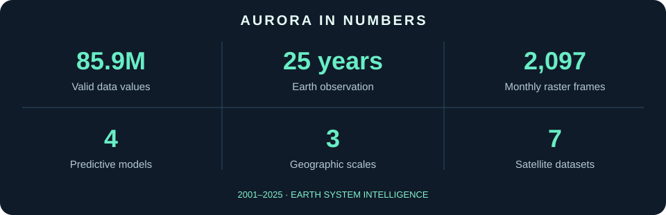
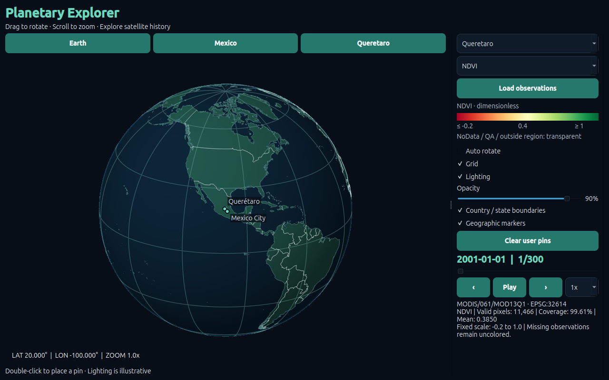
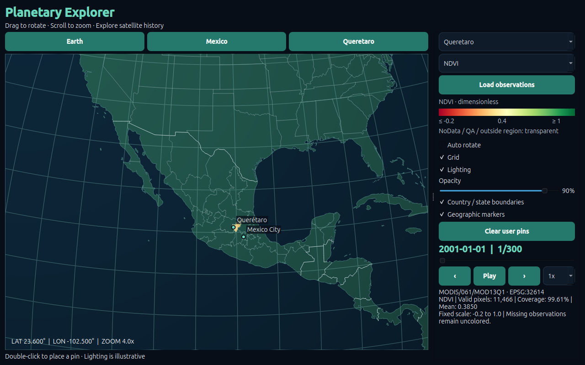
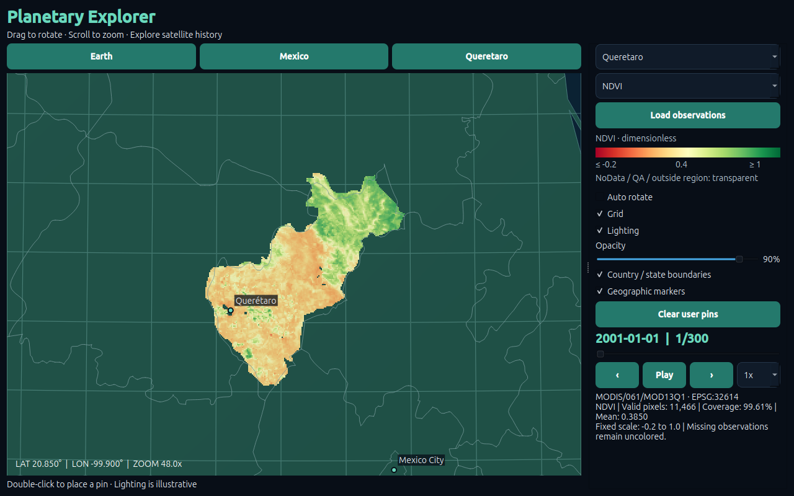
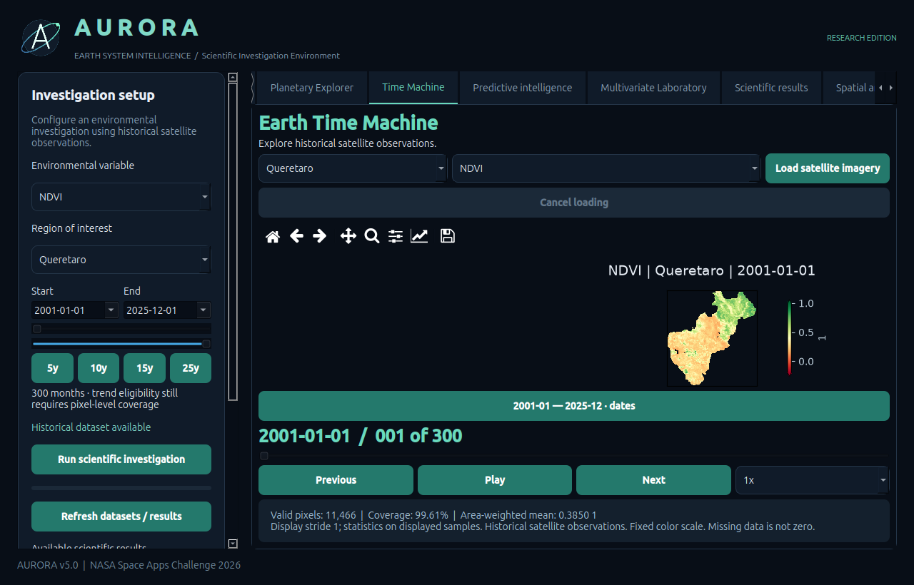
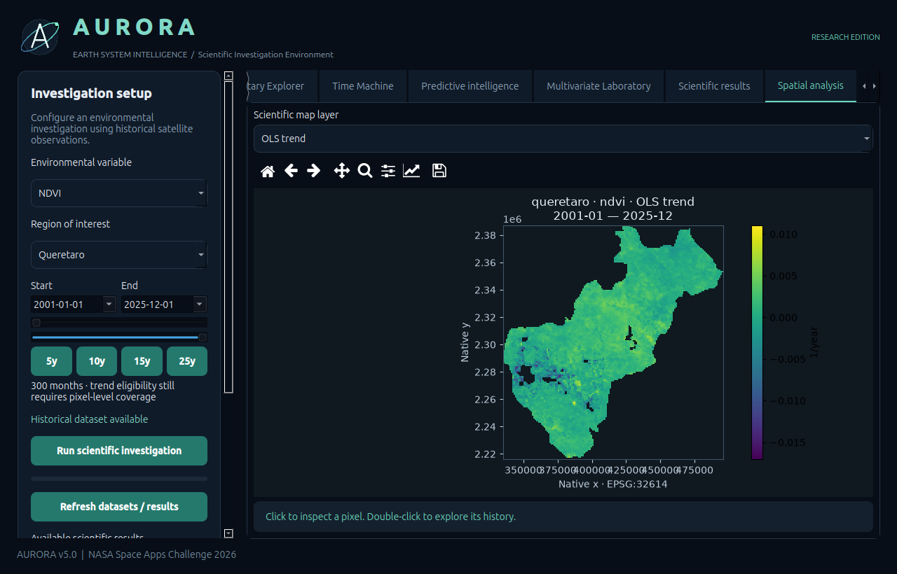
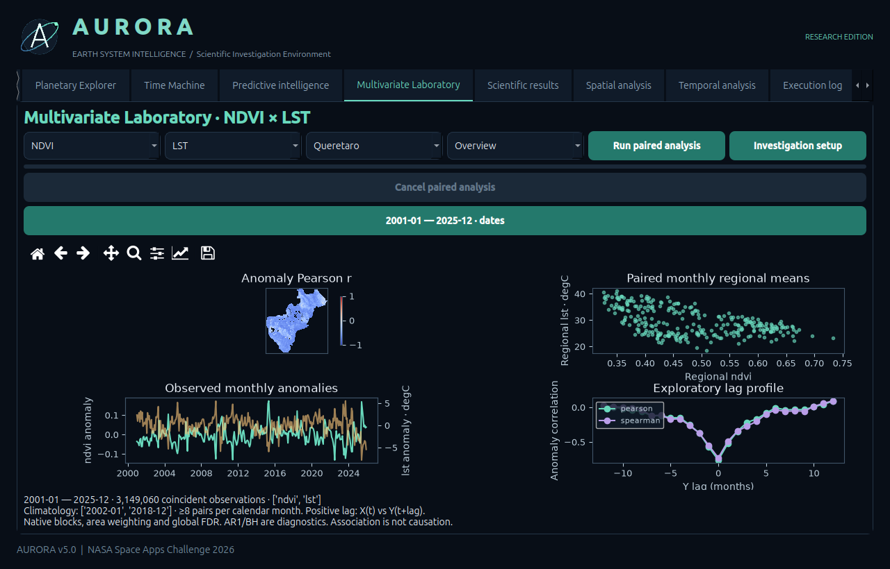
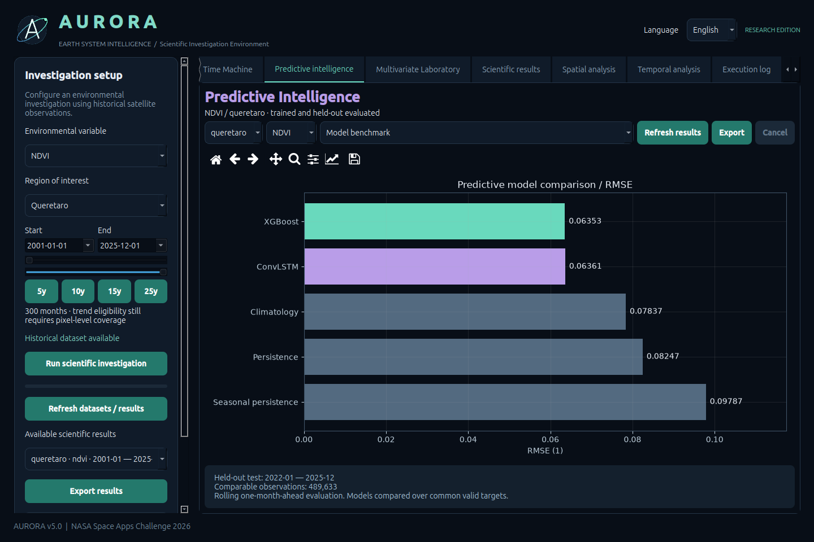
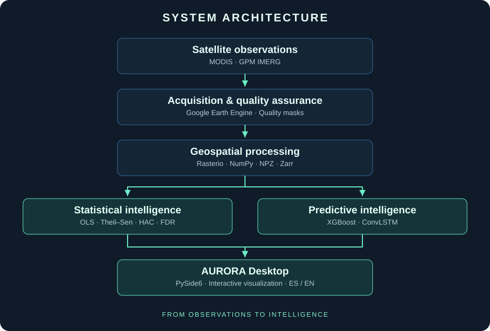
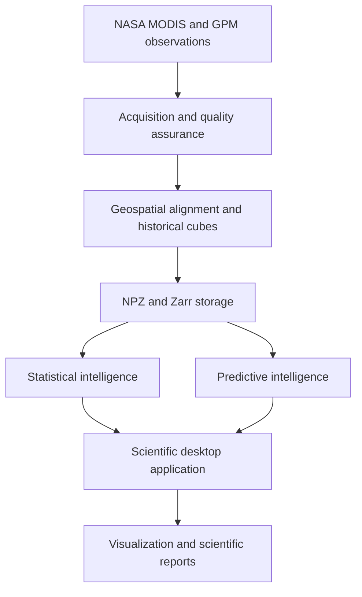

<div align="center">


<br>


# A.U.R.O.R.A.
### Earth System Intelligence

**Explore Earth. Understand change. Anticipate the future.**

NASA Space Apps Challenge 2026


[Overview](#overview) ·
[Scientific data](#scientific-data) ·
[Predictive intelligence](#predictive-intelligence) ·
[Installation](#installation) ·
[Team](#meet-the-core-team)


</div>

---

## Overview

AURORA is a scientific desktop application designed to transform
historical satellite observations into accessible environmental intelligence.

It combines geospatial processing, statistical trend analysis,
interactive visualization, machine learning and deep learning
within a bilingual scientific research environment.

Developed for the NASA Space Apps Challenge 2026:

**Be An Earth System Trend Detective!**

## AURORA in numbers

<div align="center">

</div>


| Indicator | Value |
| :--- | ---: |
| Historical period | 2001–2025 |
| Registered satellite datasets in Full RC1 | 7 |
| Monthly raster frames | 2,097 |
| Valid cell-month-variable values | 85,940,785 |
| Geographic scales | 3 |
| Final scientific result packages in Full RC1 | 12 |
| Evaluated predictive models | 4 |
| Passing tests after consolidation | 192 |
| Supported interface languages | 2 |

Valid values are spatial-temporal-variable entries, not unique raw
satellite measurements. Coverage varies by dataset and location.

## Explore Earth at three scales

<div align="center">

<table>
<tr>
<td align="center" width="33%">
<br>
<b>Global</b><br>
<sub>50 km resolution</sub>
</td>
<td align="center" width="33%">
<br>
<b>Mexico</b><br>
<sub>5 km resolution</sub>
</td>
<td align="center" width="33%">
<br>
<b>Querétaro</b><br>
<sub>1 km resolution</sub>
</td>
</tr>
</table>

<sub>Historical application screenshots.</sub>

</div>

## Scientific data

AURORA processes three environmental variables:

- **NDVI:** Normalized Difference Vegetation Index.
- **LST:** Daytime Land Surface Temperature.
- **Precipitation:** Satellite-derived precipitation rates.

| Region | Grid resolution | Variables | Monthly frames |
| :--- | ---: | :--- | ---: |
| Querétaro | 1 km | NDVI, LST | 600 |
| Mexico | 5 km | NDVI, LST | 600 |
| Global land | 50 km | NDVI, LST, precipitation | 897 |

NDVI and LST cover January 2001 through December 2025.
Global precipitation covers January 2001 through September 2025.

Missing observations remain missing. Geographic coverage is
restricted to the supplied masks and valid observations.

## Scientific capabilities

- Interactive planetary exploration.
- Historical satellite playback.
- Spatial and temporal trend analysis.
- Ordinary Least Squares and Theil–Sen estimation.
- Multiple-comparison correction using Benjamini–Hochberg FDR.
- Autocorrelation-aware sensitivity analysis.
- Multivariate correlation and lag analysis.
- Individual pixel investigations.
- Scientific reports and data exports.
- English and Spanish interfaces.

### Application gallery

The following screenshots document earlier validated development
stages of the application.

| Planetary exploration | Historical analysis |
| :---: | :---: |
|  |  |

| Spatial analysis | Multivariate laboratory |
| :---: | :---: |
|  |  |

## Predictive intelligence

AURORA includes four evaluated one-month forecasting models
for Querétaro, Mexico.

| Variable | Model | MAE | RMSE | R² |
| :--- | :--- | ---: | ---: | ---: |
| NDVI | XGBoost | 0.042175 | 0.063527 | 0.884433 |
| NDVI | ConvLSTM | 0.044379 | 0.063608 | 0.884137 |
| LST | XGBoost | 2.087552 °C | 2.830701 °C | 0.819426 |
| LST | ConvLSTM | 2.211072 °C | 3.012322 °C | 0.795511 |

Held-out evaluation period: 2022–2025.

These models have not been validated for national or global forecasting.
January 2026 inference products are retrospective model estimates,
not new satellite observations.



## Architecture

<div align="center">

</div>

<details>
<summary>Technical architecture diagram</summary>




</details>


## Distribution editions

| Feature | Lite RC1 | Full RC1 |
| :--- | :---: | :---: |
| Querétaro | Yes | Yes |
| Mexico | No | Yes |
| Global land | No | Yes |
| Registered Zarr datasets | 2 | 7 |
| Monthly raster frames | 600 | 2,097 |
| Final scientific result packages | 3 | 12 |
| Evaluated Querétaro models | 4 | 4 |
| Application ZIP size | ~92 MiB | ~718 MiB |

Archive sizes exclude separate dependency wheel archives.

RC1 archives were built and their SHA-256 checksums verified.
The corresponding unpackaged distribution directories passed local
health and CPU inference checks. Fresh installation from the final
ZIP archives remains unvalidated. Public downloads are not yet available.

## Installation

The source repository does not include the complete historical
satellite datasets or trained model artifacts.

Use the corresponding distribution package for offline exploration.

### Linux CPU

Requirements:

- Python 3.14.4.
- Linux x86-64.
- Compatible Qt system libraries.

From the extracted application directory:

```bash
bash installers/install-linux.sh
bash installers/run-linux.sh
```

An offline dependency wheelhouse can be supplied to the installer.

### Windows

PowerShell installers and dependency locks are provided, but Windows
installation, rendering and inference remain unvalidated.

For detailed instructions, see:

- [Distribution guide](docs/distribution-guide.md)
- [Runtime and portability](docs/technical/runtime-and-portability.md)

## Validation and reproducibility

The post-submission consolidation passed 192 automated tests on Linux
with no reported warnings.

Historical RC1 evidence includes CPU inference validation in both
the development environment and an independent CPU-only environment.

| Model | Maximum absolute difference |
| :--- | ---: |
| NDVI — XGBoost | 0 |
| NDVI — ConvLSTM | 0.0003101 |
| LST — XGBoost | 0 °C |
| LST — ConvLSTM | 0.0015831 °C |

All four models preserved their exact spatial masks and passed
their established numerical tolerances.

- [Distribution evidence](docs/evidence/distribution/)
- [Scientific validation](docs/validation_report.md)
- [Scientific report](docs/scientific_report_en.md)
- [Model card](docs/model_card.md)
- [Data sources](docs/data_sources.md)

## Data sources

AURORA uses NASA satellite products accessed through Google Earth Engine.

| Product | Variable |
| :--- | :--- |
| [MOD13Q1](https://developers.google.com/earth-engine/datasets/catalog/MODIS_061_MOD13Q1) | Regional NDVI |
| [MOD11A2](https://developers.google.com/earth-engine/datasets/catalog/MODIS_061_MOD11A2) | Regional LST |
| [MOD13C1](https://developers.google.com/earth-engine/datasets/catalog/MODIS_061_MOD13C1) | Global NDVI |
| [MOD21C3](https://developers.google.com/earth-engine/datasets/catalog/MODIS_061_MOD21C3) | Global LST |
| [GPM IMERG V07](https://developers.google.com/earth-engine/datasets/catalog/NASA_GPM_L3_IMERG_MONTHLY_V07) | Global precipitation |

Geographic assets and third-party attribution are documented
[in the geography directory](assets/desktop/geography/README.md).

## Meet the core team

<div align="center">

<table>
<tr>
<td align="center" width="240">
<a href="https://github.com/nekoscript-exe">

</a><br>
<h3>Ian</h3>
<b>Software & AI</b><br>
<sub>Architecture · Machine Learning · Development</sub><br><br>
<a href="https://github.com/nekoscript-exe">@nekoscript-exe</a>
</td>
<td align="center" width="240">
<a href="https://github.com/tatugagy-cloud">

</a><br>
<h3>Yatzury</h3>
<b>Satellite Data & QA</b><br>
<sub>Data Acquisition · Geospatial Processing · Quality</sub><br><br>
<a href="https://github.com/tatugagy-cloud">@tatugagy-cloud</a>
</td>
<td align="center" width="240">
<a href="https://github.com/soup-l07">

</a><br>
<h3>Sophia</h3>
<b>Scientific Validation</b><br>
<sub>Statistics · Research · Scientific Visualization</sub><br><br>
<a href="https://github.com/soup-l07">@soup-l07</a>
</td>
</tr>
</table>

**Three minds. One planet. A shared vision.**

[Individual contributions](CONTRIBUTORS.md)

</div>

---

## Scientific limitations

- Correlation does not establish causation.
- Missing observations and seasonal coverage constrain inference.
- Statistical significance is not equivalent to environmental impact.
- Regional predictive models cannot be assumed to generalize globally.
- Windows and clean NVIDIA installations remain unvalidated.
- Listing datasets does not imply complete geographic observation coverage.

## NASA Space Apps submission

The historical RC1 development snapshot is preserved separately:

[v5.0.0-rc1-nasa](https://github.com/nekoscript-exe/aurora-earth-model/tree/v5.0.0-rc1-nasa)

Subsequent repository consolidation is post-submission development.

## AI assistance and licensing

OpenAI ChatGPT and Codex assisted software development and documentation.

A project license has not yet been selected by the team.
Third-party software, datasets and geographic assets retain
their respective terms and attribution requirements.

---

<div align="center">


</div>
